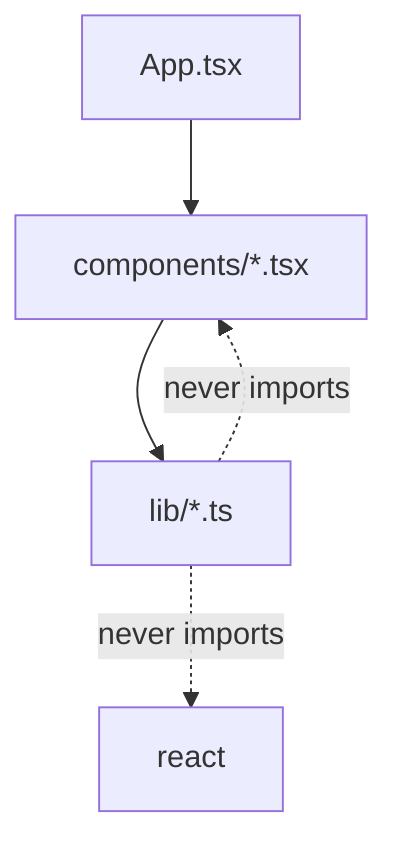
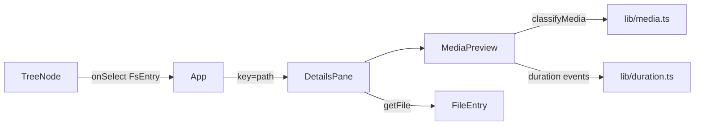

# Architecture Spine — file-browser v2 (Audio/Video)

Distilled on the fast path; the assumptions below were confirmed by the product owner on 2026-10-25.

## Design Paradigm

**Functional core, imperative shell.** This is what the code already does; v2 keeps it.

| Layer | Where | Allowed to |
| --- | --- | --- |
| Core | `src/lib/*.ts` | Pure logic and browser file APIs. No React. Tested with `*.test.ts`. |
| Shell | `src/components/*.tsx`, `src/App.tsx` | React state, effects, DOM. Calls the core. |
| Styles | `src/styles.css` | CSS variables only for new colours and sizes. |



## Invariants & Rules

### AD-1 — Extend the existing lib/components split; add no new layers [ADOPTED]

- **Binds:** all
- **Prevents:** a second structure growing beside the current one (e.g. a `media/` folder with its own components and hooks), or media logic written inside `.tsx` files where tests cannot see it.
- **Rule:**
  - All new decision logic goes in `src/lib/` as plain `.ts` (no React import). The existing files stay as they are: `types.ts`, `sources.ts`, `format.ts`, `metadata.ts`, `picker.ts`, `sort.ts`.
  - New UI goes in `src/components/` with PascalCase names, next to `DetailsPane.tsx` and `TreeNode.tsx`.
  - The `FsEntry` / `FileEntry` types stay the single way files are read. Media code uses `entry.getFile()` and nothing else. It does not touch directory handles.
  - Tests only run for `src/**/*.test.ts`, so logic that needs a test must live in a `.ts` file. A `.test.tsx` file is silently skipped.
  - `components/button.js` is legacy and not part of this design. Do not copy its style.

### AD-2 — One media classifier decides everything about a file's type

- **Binds:** FR-1, FR-3, FR-4, FR-11, FR-12, FR-15
- **Prevents:** the tree, details pane and preview each testing extensions on their own and disagreeing (e.g. `.mov` playable in one place and "not supported" in another).
- **Rule:**
  - Create `src/lib/media.ts`. It exports `classifyMedia(name, mime)` returning `'supported-video' | 'supported-audio' | 'unsupported-media' | 'other'`.
  - Supported means exactly MP4, MOV, MP3, WAV. Any other audio/video type is `unsupported-media`. A non-media file is `other`.
  - It reuses `extensionOf` from `format.ts`. The extension is the primary signal; MIME is a fallback because MIME is often empty for local files.
  - "Format not supported for playback" is shown only for `unsupported-media` (FR-15).
  - Nothing outside `media.ts` compares extensions to media formats.

### AD-3 — One media element per selection is the only source of playback and duration

- **Binds:** FR-3, FR-4, FR-5, FR-6, FR-7, FR-8, FR-10, FR-13, FR-14, NFR-1
- **Prevents:** two elements reading the same 2 GB file (a hidden "probe" plus a player), two object URLs, and a duration that disagrees with what plays.
- **Rule:**
  - For a supported file the app renders one native `<video controls>` or `<audio controls>` with `preload="metadata"`. Its `loadedmetadata` event gives the duration. Its `error` event gives failure.
  - There is no separate hidden probe element.
  - The source is `URL.createObjectURL(file)`, created when the selection starts and revoked when it ends (same pattern as the image preview in `DetailsPane`).
  - No `fetch`, no upload, no third-party player (NFR-1 and the no-runtime-dependency policy).

### AD-4 — Duration is a three-state value, formatted by the core

- **Binds:** FR-6, FR-7, FR-8, FR-9, FR-10, FR-14
- **Prevents:** a blank duration, `NaN:NaN`, or a clip rounding up to the next second.
- **Rule:**
  - `src/lib/duration.ts` exports `DurationState = { status: 'loading' } | { status: 'ready'; seconds: number } | { status: 'unknown' }` and `formatDuration(seconds)` returning `m:ss`.
  - `formatDuration` floors (15.9 becomes `0:15`). Minutes are not capped at 59: 75 minutes is `75:00`.
  - The element's `duration` maps to `unknown` when it is not finite, is `0`, or is negative (this includes `Infinity` for streams).
  - The details pane renders exactly one of: the formatted value, `Loading...`, `Unknown`. The state on selection starts as `loading`.
  - Duration is shown only for supported types (FR-6). Unsupported-media files show no duration row.

### AD-5 — Selection owns media state; changing selection discards it

- **Binds:** FR-5, FR-9, FR-10, FR-16, FR-17
- **Prevents:** audio that keeps playing after you click another file, and a slow duration from file A landing on file B.
- **Rule:**
  - Keep the existing pattern: the media area is rendered with `key={entry.path}` so every selection mounts fresh. Unmounting stops playback and revokes the URL (FR-5).
  - State is owned by one component per selection. The details rows and the preview both read from it. They do not each keep their own copy of the duration or the error.
  - Effects use the `cancelled` flag pattern already used in `DetailsPane` and `FileBadges`. A late event from an old element must not set state.
  - Only one file is selected at a time, so only one media element exists at a time. No playlist or autoplay (out of scope).

### AD-6 — Preview outcome is a closed set with fixed messages

- **Binds:** FR-11, FR-13, FR-15, FR-16, FR-17, S3
- **Prevents:** a blank preview area, different wording per component, and a slow error path.
- **Rule:**
  - For a selected audio or video file the preview pane shows exactly one of: the player, "Format not supported for playback", or "This file can't be played".
  - The two messages are constants in `src/lib/media.ts`. The text is exact, including the apostrophe in "can't".
  - The unsupported message is decided synchronously from `classifyMedia`. The file is never loaded, so the 0.5 s limit holds.
  - "This file can't be played" is shown on the element's `error` event. Name, size, and duration-or-`Unknown` stay visible in the details pane (FR-14).
  - Errors are handled inside the component. They never throw out of render, and selecting another file always works (FR-17).

### AD-7 — The tree stays cheap: no media work per row

- **Binds:** FR-1, NFR-2, S2, Counter-metric
- **Prevents:** a folder of 50 × 2 GB clips becoming slow because every row reads, decodes or probes its file.
- **Rule:**
  - `TreeNode` must not read durations, create object URLs or load media elements. Duration work starts only when a file is selected.
  - The only per-row async work allowed is what exists today: `FileBadges` calling `getFile()` for the size. Add no more. Never call `arrayBuffer()` or `text()` on a media file.
  - Media rows use the standard file icon (no thumbnails; out of scope).
  - A change that makes the S2 check or the counter-metric slower is rejected, even if the durations are correct.

### AD-8 — Look and feel come from existing styles

- **Binds:** NFR-3
- **Prevents:** a new visual style for the player and duration text.
- **Rule:**
  - Use the existing `.meta` / `Row` pattern for the duration row and the `.preview` block for the player.
  - New colours or sizes come from the CSS variables in `src/styles.css`. No inline colours. No CSS library.
  - Default browser player controls are accepted. Custom controls are out of scope.

## Consistency Conventions

| Concern | Convention |
| --- | --- |
| Naming | Components PascalCase in `src/components/`. Core files lower-camel in `src/lib/` (`media.ts`, `duration.ts`). Tests next to code as `*.test.ts`. |
| Data & formats | Durations are whole seconds, floored, `m:ss`. Sizes keep using `formatSize`. User-facing strings fixed by the PRD are named constants. |
| State & cross-cutting | React `useState` / `useEffect` only. Errors are caught where they happen and turned into a message, never an uncaught throw. No `localStorage`, no network. |
| Dependencies | `dependencies` stays React only. Dev tooling only otherwise. |

## Stack

Read from `package.json` and the code. Not a new choice.

| Name | Version |
| --- | --- |
| React / React DOM | ^19.3.1 |
| TypeScript | ^6.0.3 |
| Vite | ^8.3.4 |
| Vitest | ^5.0.5 |
| ESLint | ^10.13.0 |
| Browser APIs | File System Access API (`showDirectoryPicker`, read mode), HTMLMediaElement, `URL.createObjectURL` |

## Structural Seed

```text
src/
  lib/
    media.ts          # new: classifyMedia, message constants
    duration.ts       # new: DurationState, formatDuration, element-duration mapping
    media.test.ts     # new
    duration.test.ts  # new
    format.ts         # existing: reuse extensionOf
  components/
    MediaPreview.tsx  # new: player or message, reports DurationState up
    DetailsPane.tsx   # existing: gains the duration row; stays keyed by path
    TreeNode.tsx      # existing: unchanged in v2 (see AD-7)
```



## Capability → Architecture Map

| Requirement | Lives in | Governed by |
| --- | --- | --- |
| FR-1, FR-2 | `TreeNode`, `DetailsPane` (already list and select every file) | AD-1, AD-7 |
| FR-3, FR-4, FR-5 | `MediaPreview` | AD-3, AD-5 |
| FR-6 to FR-10 | `duration.ts`, `MediaPreview`, `DetailsPane` | AD-4, AD-5 |
| FR-11, FR-12, FR-15 | `media.ts`, `MediaPreview` | AD-2, AD-6 |
| FR-13, FR-14, FR-16, FR-17 | `MediaPreview`, `DetailsPane` | AD-5, AD-6 |
| NFR-1 | whole app | AD-3 |
| NFR-2, S2 | `TreeNode` | AD-7 |
| NFR-3 | `styles.css` | AD-8 |

## Deferred

- **FR-1 may already be done.** The scan found no file-type filter: `TreeNode` lists every file, and `format.ts` already knows mp3, wav, mp4 and mov. PRD section 8 says to confirm why media files look invisible before planning. Open a folder with a media file and check first. If the cause is not a simple filter, FR-1 must be re-scoped.
- **Stalled loads.** If the element never fires `loadedmetadata` or `error`, the pane stays on `Loading...`. Decided: no timeout in v2, because file reads are local.
- **Preview vs details layout.** Today there is one `Details` section. Whether the preview becomes a separate pane is a UX call (`ux-designs/.../EXPERIENCE.md`). It does not change AD-3 or AD-5.
- **Codec support differs by browser** (e.g. some MOV files). Those cases fall under FR-13. No transcoding.
- **Thumbnails and video previews in the tree:** deferred, see `open-questions.md`.
- **Deployment and environments:** local static Vite app, no server or backend. Nothing to decide.
